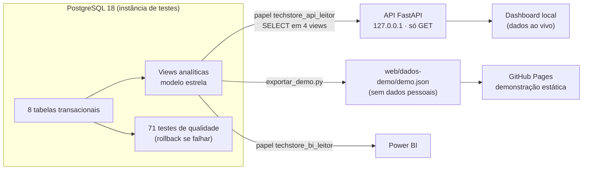
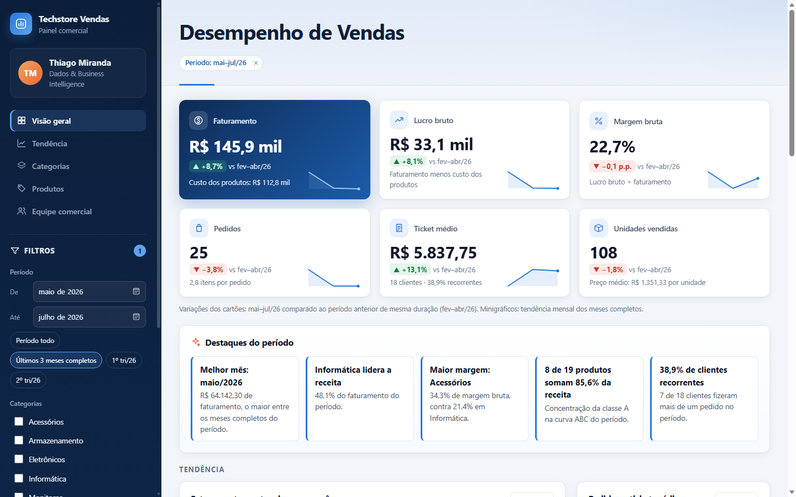

# TechStore Vendas · Análise de vendas com PostgreSQL, API e dashboard web

Projeto de portfólio que leva os dados de uma loja de tecnologia **do banco ao dashboard**:
- modelagem e correção de um banco **PostgreSQL**, com scripts reproduzíveis e testes automáticos de qualidade;
- camada analítica em **modelo estrela**;
- **API somente leitura em Python (FastAPI)**;
- **dashboard web** em HTML, CSS, JavaScript e Chart.js;
- material de redesenho do relatório **Power BI**.

> 🔗 **Dashboard online (demonstração):** `https://<seu-usuario>.github.io/<repositorio>/` *(o endereço final aparece em Settings › Pages depois da primeira publicação; ver [docs/PUBLICACAO.md](docs/PUBLICACAO.md))*
>
> ⚠️ **Dados fictícios.** Clientes, vendedores e pedidos foram criados para demonstração. Os custos de produto vêm da base de desenvolvimento do autor e também são de uma loja fictícia.


---

## Problema de negócio

A loja quer responder, com números confiáveis:
- **Quanto vendemos e com que rentabilidade?** Faturamento, custo, lucro bruto e margem por mês, categoria e produto.
- **Onde está a receita?** Concentração de faturamento (curva ABC) e categorias líderes.
- **Quem compra e quem volta a comprar?** Clientes ativos e recorrência.
- **Como está a equipe comercial?** Faturamento, margem, ticket e clientes por vendedor.

O ponto de partida foram scripts SQL que **não rodavam do zero**:
- havia uma coluna de custo inexistente;
- itens apontavam para pedidos que não existiam;
- havia pedidos anteriores ao cadastro do cliente.

Também faltava um relatório **verificável**. O projeto corrige isso, documenta cada decisão e prova os números com testes.

---

## Tecnologias

| Camada | Tecnologia | Uso no projeto |
|---|---|---|
| Banco | **PostgreSQL 18**, **SQL** | DDL com restrições, carga em transação única, views analíticas, papéis de acesso, 71 testes de qualidade em SQL |
| API | **Python 3.12**, **FastAPI**, **psycopg 3**, **pytest** | 7 endpoints somente leitura e 55 testes (reconciliação, segurança e privilégios) |
| Dashboard | **HTML**, **CSS**, **JavaScript** (módulos ES), **Chart.js 4.4.7** (cópia local) | Painel responsivo, com filtros, comparação entre períodos e tabelas acessíveis |
| BI | **Power BI**, **DAX**, **Power Query (M)** | Relatório original do autor e material de redesenho: tema, consultas com parâmetros e 35 medidas DAX |
| Publicação | **GitHub Actions**, **GitHub Pages** | Publicação automática da demonstração estática |

---

## Arquitetura



- **Localmente**, o dashboard consulta a API, que lê o PostgreSQL com um usuário que **só enxerga 4 views**. O navegador nunca acessa o banco.
- **Na demonstração pública**, a mesma interface carrega `demo.json` e recalcula os indicadores no navegador ([web/js/demo.js](web/js/demo.js)). Fora de `localhost`, o modo de demonstração é **forçado**, e a página nunca tenta acessar a API nem o banco.
- **A demonstração é comprovadamente equivalente à API:** em 482 comparações (8 períodos × 10 combinações de filtros × todos os endpoints), houve 0 divergências.

Mais detalhes em [docs/DASHBOARD_WEB.md](docs/DASHBOARD_WEB.md).

---

## Modelagem de dados

- **Modelo relacional:** 8 tabelas (`cliente`, `endereco`, `telefone`, `vendedor`, `categoria`, `produto`, `pedido`, `itens_pedido`), com:
  - 7 chaves estrangeiras, 13 regras CHECK e 6 índices;
  - **custo histórico por item** (`itens_pedido.custo_unitario`), para que mudanças futuras no catálogo não reescrevam a margem do passado.
- **Modelo dimensional (estrela):**
  - `vw_fato_vendas`, com uma linha por item e só chaves e medidas;
  - `vw_dim_produto`, `vw_dim_vendedor` e `vw_dim_cliente`, **sem CPF, e-mail, telefone ou salário**;
  - `vw_dim_calendario`, com nomes em português e a situação de cada mês (completo ou parcial).

Diagramas em [docs/MODELO_DE_DADOS.md](docs/MODELO_DE_DADOS.md) e colunas em [docs/DICIONARIO_DE_DADOS.md](docs/DICIONARIO_DE_DADOS.md).

---

## SQL: o que foi desenvolvido

| Script | Conteúdo | Técnicas |
|---|---|---|
| [00_executar_tudo.sql](database/00_executar_tudo.sql) | Executor | Trava de banco, `ON_ERROR_STOP`, **transação única** (tudo ou nada) |
| [01](database/01_estrutura.sql) · [02](database/02_restricoes_indices.sql) | Estrutura e integridade | `IDENTITY`, PK, FK, `UNIQUE`, `CHECK` com expressão regular, índices em chaves estrangeiras |
| [03](database/03_dados_base.sql) · [04](database/04_dados_gerados.sql) | Carga | Verificações de pré-condição, `generate_series`, `LATERAL`, `ROW_NUMBER`, `INSERT ... RETURNING` numa única instrução |
| [05_custos_carga.sql](database/05_custos_carga.sql) | Custos | Tabela temporária de carga, conferência por nome, rastreabilidade da origem |
| [06_views.sql](database/06_views.sql) | Views | Contrato fixo para o Power BI e camada estrela |
| [07_consultas_analiticas.sql](database/07_consultas_analiticas.sql) | 19 consultas | Agregações, `RANK`, ticket médio, ranking de vendedores |
| [08_verificacoes_qualidade.sql](database/08_verificacoes_qualidade.sql) | **71 testes** | Reconciliação de totais, integridade temporal, órfãos, contrato da view, ausência de dados pessoais |
| [09](database/09_acesso_leitura_bi.sql) · [10](database/10_acesso_leitura_api.sql) | Acesso | Papéis com privilégio mínimo (`SELECT` só em views) |

**Consultas da API** ([api/techstore_api/consultas/](api/techstore_api/consultas/)): série mensal com `LAG` e média móvel `AVG OVER (ROWS 2 PRECEDING)`, curva ABC com soma acumulada e `DENSE_RANK`, comparação do último mês completo e recorrência de clientes.

Cada correção feita nos scripts originais está registrada, com evidência, em [docs/DECISOES_E_CORRECOES.md](docs/DECISOES_E_CORRECOES.md).

---

## Dashboard: indicadores e funcionalidades

- **Indicadores:**
  - faturamento, lucro bruto, margem bruta, pedidos, ticket médio e unidades;
  - cada um com um minigráfico da tendência mensal;
  - comparação com o **período anterior de mesma duração**, só quando ela é válida.
- **Destaques do período**, calculados a partir dos dados: melhor mês, categoria líder, maior e menor margem, concentração ABC e recorrência.
- **Análises:**
  - faturamento, custo e lucro por mês, com média móvel;
  - pedidos e ticket médio;
  - participação e margem por categoria, com a margem geral como referência;
  - curva ABC;
  - produtos mais rentáveis;
  - ranking de vendedores.
- **Filtros:**
  - período, com atalhos de trimestre e de últimos 3 meses;
  - categorias e vendedores, combináveis;
  - etiquetas removíveis e botão de redefinir;
  - **filtros refletidos na URL**, para compartilhar uma visão filtrada.
- **Qualidade de uso:**
  - layout responsivo (lateral vira menu deslizante no celular);
  - tabela alternativa para os gráficos e navegação por teclado;
  - mês parcial sinalizado;
  - estados de "sem vendas" e "fonte indisponível".

| Comparação entre períodos | Celular | Menu no celular |
|---|---|---|
|  |  |  |

---

## Power BI

- **Incluído no repositório:**
  - [tema visual](powerbi/tema/TechstoreVendas.json);
  - [consultas Power Query com parâmetros de ambiente](powerbi/modelo/consultas_power_query.m);
  - [35 medidas DAX](powerbi/modelo/medidas.dax) (variação mensal, acumulado no ano, média móvel, curva ABC, recorrência);
  - [guia de implementação](docs/POWERBI_GUIA.md), com os valores de referência para conferir cada medida.
- **Não incluído:** o arquivo `.pbix` do relatório original. Ele contém identificadores do Power BI Service, um bloco de credenciais criptografado da fonte de dados e um modelo de dados binário que não pode ser auditado. Por segurança, fica só no repositório local do autor.
- **Limitação:** o material de redesenho não foi testado dentro do Power BI Desktop. Os valores de referência foram calculados no PostgreSQL.

---

## Estrutura do repositório

```
database/        Scripts SQL reproduzíveis (00 executor · 01–06 carga · 07 consultas · 08 testes · 09–10 acesso)
api/             API FastAPI (techstore_api/), consultas SQL fixas, testes, exportador da demonstração
web/             Dashboard (HTML/CSS/JS), Chart.js local e dados da demonstração (dados-demo/)
powerbi/         Tema, consultas Power Query e medidas DAX (sem .pbix)
docs/            Decisões, modelo, dicionário, validação, dashboard, Power BI, ambiente, publicação
docs/evidencias/ Saídas reais das execuções de validação do banco
docs/imagens/    Capturas de tela
sql/             Scripts originais, preservados como histórico (não executar; ver as correções C2–C5)
documentacao/    Diagrama conceitual original (BRModelo)
scripts/         Geração do branch de publicação
.github/         Publicação automática no GitHub Pages
```

---

## Como executar localmente

Pré-requisitos: **PostgreSQL 15 ou mais novo** (validado no 18) com `psql`, e **Python 3.12**.

**1. Banco de dados**, sempre num banco novo e vazio de testes. Nunca use um banco com dados reais.
```bash
createdb -h localhost -p 5433 -U <administrador> -O <usuario> techstore_dev_v1
psql "host=localhost port=5433 dbname=techstore_dev_v1 user=<usuario>" -X -v ON_ERROR_STOP=1 -f database/00_executar_tudo.sql
```
Resultado esperado: a tabela de testes sem nenhuma FALHA e a mensagem `Carga concluída e validada.` O executor só aceita bancos `techstore_dev*`.

**2. Usuário somente leitura da API.** Crie o papel, defina a senha com `\password` e conceda o acesso; os comandos estão no cabeçalho de [database/10_acesso_leitura_api.sql](database/10_acesso_leitura_api.sql).
```bash
psql "host=localhost port=5433 dbname=techstore_dev_v1 user=<usuario>" -X -f database/10_acesso_leitura_api.sql
```

**3. API e dashboard (Windows/PowerShell)**
```powershell
cd api
python -m venv .venv
.\.venv\Scripts\python.exe -m pip install -r requirements-dev.txt
powershell -ExecutionPolicy Bypass -File criar_env.ps1   # cria api\.env com a senha digitada de forma oculta (fora do Git)
.\.venv\Scripts\python.exe -m techstore_api              # http://127.0.0.1:8000
```
Ajuste o banco e a porta em `api\.env`, se forem diferentes do modelo [api/.env.exemplo](api/.env.exemplo).

**4. Demonstração estática, localmente:** `http://127.0.0.1:8000/?fonte=demo`, ou qualquer servidor estático apontado para `web/`.

**5. Atualizar os dados da demonstração** depois de mudar o banco: `.\.venv\Scripts\python.exe exportar_demo.py`, dentro de `api/`.

O passo a passo completo, incluindo a instância de testes isolada, está em [docs/AMBIENTE_DE_VALIDACAO.md](docs/AMBIENTE_DE_VALIDACAO.md) e [docs/DASHBOARD_WEB.md](docs/DASHBOARD_WEB.md).

---

## Testes

| Camada | Como executar | Resultado validado |
|---|---|---|
| Banco | `database/00_executar_tudo.sql` (roda o `08`) | **71/71** testes bloqueantes; reexecução sem alterar nada (impressão digital idêntica) |
| API | `cd api` e `.\.venv\Scripts\python.exe -m pytest` | **55/55**: reconciliação com os valores de referência, segurança (entradas, métodos, cabeçalhos, CORS, ausência de dados pessoais) e privilégios reais do papel |
| Demonstração estática | Mesmo comando (ou `python -m pytest api/tests/test_demo_estatica.py --noconftest`, sem banco) | **10/10**: valores de referência, ausência de dados pessoais, arquivos com a grafia exata e modo demonstração fora de localhost. Também roda no workflow, antes de cada publicação |
| Demonstração × API | Comparação automatizada | **482/482** respostas idênticas, sem nenhuma requisição à API |
| Interface | Navegador automatizado (Edge, protocolo DevTools) | Filtros, combinações, URL, estado vazio, 7 larguras de tela, menu do celular; 0 erros de console do projeto |

Os valores de referência são faturamento **R$ 335.062,30**, custo **R$ 258.699,00**, lucro **R$ 76.363,30** e margem **22,79%**. Evidências em [docs/VALIDACAO.md](docs/VALIDACAO.md) e [docs/evidencias/](docs/evidencias/).

---

## Limitações conhecidas

| Limitação | Efeito |
|---|---|
| Dados fictícios gerados por regra | A distribuição entre vendedores é quase uniforme por construção; rankings e sazonalidade não representam comportamento real |
| 7,5 meses de vendas (jan a ago/2026) | Não há comparação com o ano anterior |
| Agosto/2026 parcial (até o dia 18) | Sinalizado e excluído das comparações entre períodos |
| Estoque é uma foto do momento | A cobertura de estoque usa o estoque atual |
| Endereço só para 10 de 40 clientes, todos no RJ | Não há análise geográfica |
| Custo histórico | Foi registrado a partir do custo atual na carga inicial (não existe histórico real anterior) |
| Demonstração pública | Usa um retrato estático dos dados; não consulta o banco ao vivo |
| API | Feita para uso local, sem autenticação de usuários nem TLS |
| Navegadores | A interface foi validada no Edge (Chromium); Firefox e Safari não foram testados |

---

## Documentação

| Documento | Conteúdo |
|---|---|
| [DECISOES_E_CORRECOES.md](docs/DECISOES_E_CORRECOES.md) | Cada correção (C1–C14), com evidência e o trecho original correspondente |
| [MODELO_DE_DADOS.md](docs/MODELO_DE_DADOS.md) · [DICIONARIO_DE_DADOS.md](docs/DICIONARIO_DE_DADOS.md) | Diagramas e colunas, com classificação de dados pessoais |
| [VALIDACAO.md](docs/VALIDACAO.md) | Execuções reais e reconciliação |
| [DASHBOARD_WEB.md](docs/DASHBOARD_WEB.md) | API, segurança, frontend, demonstração e testes |
| [POWERBI_GUIA.md](docs/POWERBI_GUIA.md) | Implementação do modelo e das medidas no Power BI |
| [AMBIENTE_DE_VALIDACAO.md](docs/AMBIENTE_DE_VALIDACAO.md) | Instância PostgreSQL isolada para testes |
| [PUBLICACAO.md](docs/PUBLICACAO.md) | Como o repositório e o dashboard são publicados |

---

**Autor:** Thiago Miranda · Dados & Business Intelligence
