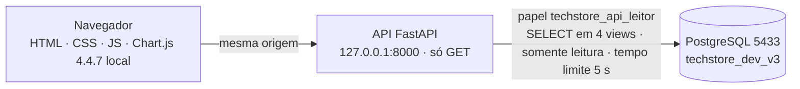
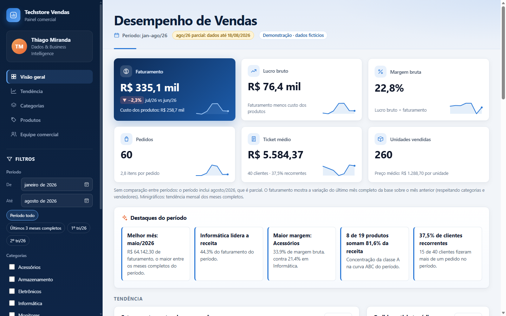
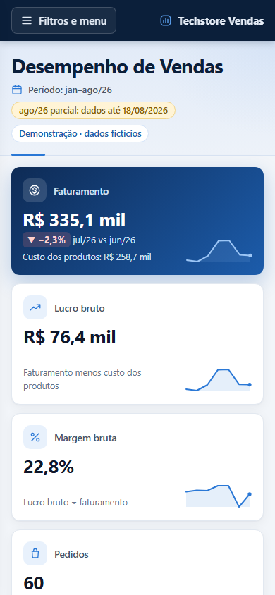
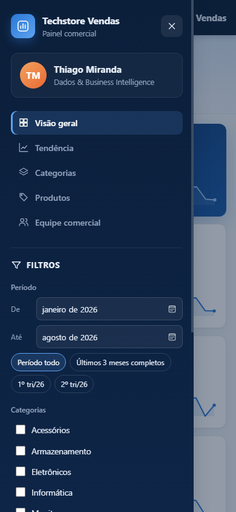

# Dashboard web: API e frontend

Dashboard executivo em **HTML, CSS, JavaScript e Chart.js**, servido por uma **API somente leitura em Python (FastAPI e psycopg 3)**. A API lê apenas as views analíticas da instância de testes.

> **Situação (2026-10-15):**
> - API concluída: **55/55 testes** com o papel real `techstore_api_leitor`.
> - Primeira versão do frontend (Visão Executiva) **integrada ao banco** por esse papel.
>
> Ver [tarefas em aberto](#tarefas-em-aberto).

---

## Arquitetura



O navegador nunca acessa o banco. A API nunca acessa tabelas, só as views `vw_fato_vendas`, `vw_dim_produto`, `vw_dim_vendedor` e `vw_dim_calendario` ([C14](DECISOES_E_CORRECOES.md)).

## Como executar

```powershell
# 1. Uma vez: senha do papel da API (na instância de testes, como administrador)
psql "host=localhost port=5433 dbname=postgres user=pgdev_admin" -X   # psql do PostgreSQL 18 (no PATH ou pelo caminho completo)
#    \password techstore_api_leitor
#    \q

# 2. Uma vez: criar api\.env com a mesma senha, digitada de forma oculta
powershell -ExecutionPolicy Bypass -File api\criar_env.ps1

# 3. Subir a API (e o frontend, quando existir)
cd api
.\.venv\Scripts\python.exe -m techstore_api
#    http://127.0.0.1:8000/api/saude
```

**Ambiente Python:** 3.12.10, instalado só para o usuário e sem alterar o PATH. Ambiente virtual em `api\.venv` (fora do Git). Dependências fixadas em [`api/requirements.txt`](../api/requirements.txt) e [`api/requirements-dev.txt`](../api/requirements-dev.txt).

Para recriar o ambiente:
```powershell
& "$env:LOCALAPPDATA\Programs\Python\Python312\python.exe" -m venv api\.venv
api\.venv\Scripts\python.exe -m pip install -r api\requirements-dev.txt
```

## Endpoints

Todos são `GET` e respondem JSON.

**Filtros comuns** (os parâmetros podem ser repetidos):
- `inicio` e `fim`: datas `AAAA-MM-DD`;
- `categoria`: ID, até 20 valores;
- `vendedor`: ID, até 20 valores.

| Endpoint | Parâmetros | Retorna |
|---|---|---|
| `/api/saude` | — | Situação, primeira e última venda |
| `/api/filtros` | — | Período disponível, categorias e vendedores (`id`, `nome`) |
| `/api/kpis` | filtros | Faturamento, custo, lucro, margem, pedidos, unidades, ticket, itens por pedido, clientes ativos e recorrentes. Também o último mês completo com a variação, que ignora o período, como no DAX |
| `/api/vendas-mensais` | filtros | Série mensal com variação (em branco no mês parcial) e média móvel de 3 meses. O período é tratado em **meses inteiros** |
| `/api/categorias` | filtros | Faturamento, custo, lucro e margem por categoria |
| `/api/produtos` | filtros e `limite` (1–50, padrão 5) | Ranking, % do faturamento, % acumulado e classe ABC (calculada sobre todos os produtos do filtro) |
| `/api/vendedores` | filtros | Ranking, faturamento, lucro, margem, pedidos, ticket e clientes |

As consultas SQL são fixas e parametrizadas, cada uma num arquivo de [`api/techstore_api/consultas/`](../api/techstore_api/consultas/).

## Segurança

| Camada | Controle |
|---|---|
| Banco (papel) | `SELECT` só em 4 views. Sessões `default_transaction_read_only = on` e `statement_timeout = 5s`. `CONNECTION LIMIT 10`. Nenhum atributo especial |
| Banco (API) | O pool repete as mesmas opções de sessão (proteção em profundidade). A senha fica fora da string de conexão e dos logs |
| Credenciais | `api\.env`, criado por `criar_env.ps1` com a senha digitada de forma oculta e permissão só para o usuário. Ignorado pelo Git; versiona-se só o `.env.exemplo`, sem valores |
| Rede | A API só sobe em endereço local (`127.0.0.1`, `localhost` ou `::1`) e só aceita banco local. Hosts diferentes de `127.0.0.1` e `localhost` são recusados (proteção contra *DNS rebinding*) |
| Entradas | Tipos validados. IDs conferidos contra os valores existentes. Parâmetros desconhecidos recusados. Listas com no máximo 20 itens. `inicio` não pode ser depois de `fim`. Respostas de erro 400 genéricas |
| Métodos | Só `GET` (os outros recebem 405) |
| Cabeçalhos | CSP `default-src 'self'` (sem scripts externos nem inline), `nosniff`, `X-Frame-Options: DENY`, `Referrer-Policy: no-referrer`, `Permissions-Policy`, COOP/CORP, `Cache-Control: no-store` na API. Sem cabeçalho `server` |
| Erros | Mensagens genéricas, sem detalhes técnicos. O log registra só o tipo do erro |
| Documentação interativa | Desativada (`/docs` e `/openapi.json`), porque depende de scripts externos |
| Dados pessoais | As views não têm dados pessoais. Um teste verifica que nenhuma resposta contém chaves como CPF, e-mail, telefone ou salário |
| Dependências | Versões fixadas; `pip-audit` sem vulnerabilidades conhecidas (2026-10-15) |

## Testes (`api\tests`)

```powershell
cd api
.\.venv\Scripts\python.exe -m pytest
```

| Arquivo | O que prova |
|---|---|
| `test_reconciliacao.py` | KPIs, último mês completo, 8 meses (variação e média móvel), 6 categorias, 5 vendedores, curva ABC (8 A, 6 B, 5 C), filtros por categoria, vendedor e período, e consistência entre endpoints. Tudo comparado com os valores de referência de [VALIDACAO.md](VALIDACAO.md) |
| `test_seguranca.py` | Entradas inválidas e maliciosas → 400; métodos → 405; host externo → 400; cabeçalhos; documentação desativada; nenhum dado pessoal; erro 500 sem detalhes; configuração recusa host não local; senha fora do `repr`; sessões do pool somente leitura |
| `test_privilegios.py` | Com o papel `techstore_api_leitor`: lê as 4 views; é **barrado** em 5 tabelas, `vw_dim_cliente` e `vw_vendas`; sessão do papel somente leitura com 5 s; sem atributos especiais. Pulado automaticamente se a API usar outro usuário |

**Resultado final em 2026-10-15, com o papel real `techstore_api_leitor` (credencial em `api\.env`): 55 testes aprovados, 0 pulados, 0 falhas.**
- **Privilégio (10):**
  - lê `vw_fato_vendas`, `vw_dim_produto`, `vw_dim_vendedor` e `vw_dim_calendario`;
  - `permissão negada` em `cliente`, `pedido`, `itens_pedido`, `produto`, `vendedor`, `vw_dim_cliente` e `vw_vendas`;
  - sessão do papel com `default_transaction_read_only = on` e `statement_timeout = 5s`, e tentativa de escrita recusada;
  - nenhum atributo especial.
- **Reconciliação (10):** todos os valores de referência exatos com o usuário real.
- **Segurança (35):** incluindo 6 testes de CORS.

**Histórico:**
- Antes da senha, os testes rodaram com `techstore_dev_app`: 45 aprovados e 10 pulados.
- A primeira tentativa com o `.env` falhou na autenticação. O log da instância 5433 mostrou `Usuário "techstore_api_leitor" não tem senha atribuída`: o `.env` tinha senha, mas o `\password` ainda não tinha sido aplicado no banco. O autor definiu a senha, o catálogo confirmou `tem_senha = t` e os testes passaram.
- Nenhuma permissão ou configuração foi alterada para isso.

**Teste manual** com o servidor real (uvicorn):
- `/api/saude` responde 200 com todos os cabeçalhos;
- `/api/kpis` retorna R$ 335.062,30;
- `POST` recebe 405 e host externo recebe 400;
- o servidor escuta em `127.0.0.1:8000`.

## Frontend: painel "Desempenho de Vendas" (`web/`)



### Organização
- **Lateral azul-marinho:**
  - marca e identificação do autor (**Thiago Miranda · Dados & Business Intelligence**);
  - navegação por seções, que destaca a seção visível;
  - filtros: período por mês e atalhos (período todo, últimos 3 meses completos, trimestres completos), categorias, vendedores;
  - contador de filtros ativos e **Redefinir filtros**;
  - selo de dados fictícios e status da conexão.
- **Abaixo de 1024 px:** a lateral vira um **painel deslizante** aberto por "Filtros e menu", com fundo escurecido, Esc para fechar, foco gerenciado e o atributo `inert` quando fechado.
- **Cabeçalho:** faixa **clara de borda a borda**, em degradê azul-gelo, com o título **"Desempenho de Vendas"** em azul-marinho como protagonista. A ligação com a lateral vem do tom do título, não de uma massa de cor, e uma linha fina com acento azul na base separa o cabeçalho do conteúdo. Essa solução foi escolhida depois de comparar quatro alternativas:
  - faixa azul-marinho (pesada);
  - sem fundo (pouco destaque);
  - cartão claro (parecia mais um cartão de conteúdo);
  - cartão azul médio (competia com o cartão de faturamento).

  Abaixo do título, em tom secundário, ficam só:
  - o período aplicado;
  - o aviso de mês parcial, quando houver;
  - as **etiquetas removíveis** de cada filtro ativo.

  Com o período filtrado, a etiqueta já mostra o período, e a linha estática some para não repetir. A identificação do projeto e o aviso de dados fictícios ficam na lateral e no rodapé, não no cabeçalho.
- **Seções:** Visão geral (indicadores e destaques) · Tendência · Categorias · Produtos · Equipe comercial.
- **Filtros na URL** (`?de=2026-05&ate=2026-07&categoria=1`): visões filtradas podem ser compartilhadas. Valores inválidos ou fora do intervalo com dados são ignorados.

### Indicadores e análises

| Elemento | Conteúdo | Fonte (API) |
|---|---|---|
| 6 cartões | Faturamento (destaque), lucro bruto, margem bruta, pedidos, ticket médio, unidades vendidas. Cada um com contexto e minigráfico da tendência mensal (meses completos) | `/api/kpis`, `/api/vendas-mensais` |
| Variações | **Período anterior de mesma duração** (ex.: mai–jul/26 contra fev–abr/26), só quando é válida: há dados para o período anterior e o período atual não inclui o mês parcial. Senão, a nota explica o motivo e o faturamento mostra o último mês completo contra o anterior. Margem em **pontos percentuais** | segunda chamada a `/api/kpis` |
| Destaques do período | Melhor mês completo, categoria líder, maior e menor margem, concentração da classe A, recorrência de clientes. Frases montadas a partir dos dados retornados | KPIs, série, categorias, produtos |
| Faturamento, custo e lucro por mês | Barras empilhadas (custo + lucro = faturamento) e média móvel de 3 meses; mês parcial esmaecido | `/api/vendas-mensais` |
| Pedidos e ticket médio | Dois minigráficos (pedidos em barras, ticket em linha), sem eixo duplo | `/api/vendas-mensais` |
| Participação no faturamento | Lista com barras, % do total, unidades e margem | `/api/categorias` |
| Margem por categoria | Barras com **linha de referência da margem geral**: azul acima, cinza abaixo | `/api/categorias` |
| Curva ABC | Barras por classe (tons ordinais de azul) e % acumulado num **único eixo de porcentagem**, com resumo por classe | `/api/produtos?limite=50` |
| Produtos mais rentáveis | Top 5 por lucro bruto, com margem | `/api/produtos` |
| Ranking de vendedores | Faturamento com barra e participação, lucro, margem, pedidos, ticket e clientes | `/api/vendedores` |

**Valores derivados no navegador** (simples divisões de valores da API, sem regra nova):
- ticket médio mensal = faturamento ÷ pedidos do mês;
- margem mensal = lucro ÷ faturamento;
- preço médio por unidade = faturamento ÷ unidades;
- participação = valor ÷ total do filtro.

**Removido:** a versão anterior trazia "Top 5 produtos por faturamento" como gráfico separado. Ele foi absorvido pela curva ABC, que mostra o ranking completo, e substituído por **produtos mais rentáveis**, uma visão nova.

### Identidade visual
- Lateral `#0B1F3A`, área de trabalho `#F2F5F9`, cartões brancos com sombra suave, acento `#2A78D6`. O cartão de faturamento tem degradê `#0E2B55 → #1C5CAB`.
- **Cores de dados:**
  - azul para a série principal;
  - laranja para média móvel e % acumulado;
  - cinza para custo e para "abaixo da média";
  - 3 tons ordinais de azul para as classes A, B e C.
- Verde e vermelho só nas variações, **sempre com seta e sinal**.
- Fonte do sistema (Segoe UI no Windows), sem fontes externas. Ícones SVG desenhados no próprio código (`js/icones.js`), sem biblioteca.

| Arquivo | Papel |
|---|---|
| `index.html` | Estrutura, CSP em meta tag (também na Live Preview) |
| `css/estilos.css` | Identidade visual, grade responsiva (1360, 1180, 1024 e 640 px), estados de carregamento, vazio e sem conexão |
| `js/config.js` · `js/api.js` | Endereço da API e `fetch` só GET, sem credenciais |
| `js/formatos.js` | pt-BR: moeda, %, p.p., intervalos de meses, variações com seta e sinal |
| `js/icones.js` | Ícones SVG criados via DOM |
| `js/graficos.js` | 5 gráficos Chart.js (sem eixo duplo), rótulos na ponta, linha de referência |
| `js/app.js` | Lateral, filtros, URL, comparação de períodos, cartões, destaques, listas, tabela, tabelas alternativas, estados |

**Regras seguidas:**
- todo dado da API entra por `textContent`;
- sem scripts externos nem `style` em linha;
- variação nunca indicada só pela cor;
- nenhum gráfico com dois eixos Y;
- tabela alternativa para os gráficos;
- foco visível e `prefers-reduced-motion` respeitados.

| Celular | Celular com menu aberto |
|---|---|
|  |  |

**Prévia no VS Code (Live Preview):**
1. Suba a API: `powershell -ExecutionPolicy Bypass -File api\iniciar_previa.ps1`.
2. No VS Code, abra `web/index.html` e escolha **Live Preview: Show Preview** (ícone de prévia no canto superior direito do editor, ou `Ctrl+Shift+P`).
3. A Live Preview serve a página em `http://127.0.0.1:3000/web/index.html`. A API libera essa origem (e `localhost:3000`) por CORS de desenvolvimento.

Se a Live Preview usar outra porta, inclua-a em `TECHSTORE_API_ORIGENS_DEV`. Também é possível abrir `http://127.0.0.1:8000/` direto no navegador (mesma origem, com todos os cabeçalhos de segurança). Pelo painel embutido do VS Code isso não funciona, por causa do `X-Frame-Options: DENY`.

**Arquivos atualizados e cache do navegador.** A API serve os arquivos estáticos sem `Cache-Control`. Assim, o navegador pode reaproveitar por algum tempo uma versão antiga de um `.js` ou `.css` depois de uma alteração. Ao abrir por `http://127.0.0.1:8000/`, use **Ctrl+F5** para forçar a versão nova. A validação automatizada roda com o cache desligado.

A CSP da meta tag libera também `ws://127.0.0.1:3001`, o WebSocket de recarga automática da Live Preview. Servida pela API, a página recebe ainda a CSP do cabeçalho (`connect-src 'self'`), e as duas valem ao mesmo tempo.

### Validação automatizada (2026-10-15)

O Edge sem janela foi controlado pelo protocolo DevTools a partir do PowerShell, sem instalar nada. Em cada estado, um script **dentro da página** comparou o que está na tela com a resposta da API para os mesmos filtros:
- os 6 KPIs;
- os dados dos 5 gráficos;
- as listas de participação e de rentáveis;
- a tabela de vendedores.

| Cenário | Resultado |
|---|---|
| Padrão; Acessórios; + Juliana Mendes; + 2º tri/26; remover etiqueta; redefinir | ✅ Todos os valores iguais aos da API. Redefinir volta a R$ 335.062,30, sem filtros e com URL limpa |
| Comparação 2º tri × 1º tri (Acessórios + Juliana) | ✅ `▲ +792,4% vs jan–mar/26`, igual ao cálculo independente feito com a API |
| Link direto mai–jul/26 + 2 categorias | ✅ Valores e variações contra fev–abr/26 |
| URL com valores inválidos | ✅ Ignorados (visão padrão) |
| Combinação sem vendas (jan/26 + Informática + Carlos Henrique) | ✅ Cartões com "—", estado vazio em todos os gráficos e nota coerente |
| 1920, 1366, 1180, 1024, 820, 390 e 360 px | ✅ Valores corretos, **sem estouro horizontal** e sem textos cortados |
| Menu no celular | ✅ Abre (`inert` desligado, foco no botão fechar), filtra, fecha com Esc (foco devolvido, contador na barra) |
| Alternar gráfico e tabela | ✅ |
| Pela Live Preview (`127.0.0.1:3000`) | ✅ Dados completos via CORS de desenvolvimento |
| API parada | ✅ Aviso "API local indisponível" com a instrução, filtros ocultos, status vermelho |
| "Tentar novamente" após a API voltar | ✅ Recarrega com os valores corretos |
| API cai durante o uso | ✅ Alerta exibido, indicadores anteriores mantidos |
| Console | ✅ **0 erros ou avisos do painel**. Os únicos avisos vêm de uma extensão interna do Edge (`chrome-extension://ejbalbak…`) |

Capturas adicionais: [página inteira](imagens/painel_desktop_pagina_inteira.png) · [comparação entre períodos](imagens/painel_comparacao_periodos.png).

## Demonstração pública

O mesmo frontend roda em dois modos, decididos em `web/js/config.js`:

| Modo | Quando | Fonte dos dados |
|---|---|---|
| **API** | Página aberta em `localhost`/`127.0.0.1` | API local (`/api/...`), que lê o PostgreSQL de teste |
| **Demonstração** | Qualquer outro endereço (ex.: GitHub Pages) ou `?fonte=demo` em endereço local | `web/dados-demo/demo.json`, calculado no navegador por `web/js/demo.js` |

- **Sem código de interface duplicado:** só `api.js` muda de rota. Em modo demonstração, ele importa `demo.js`, que responde aos mesmos caminhos e parâmetros da API. Os filtros, os gráficos e a URL compartilhável são os mesmos.
- **Nenhum acesso à máquina local:** em modo demonstração não há `fetch` para a API. O cabeçalho mostra "Demonstração · dados fictícios" e o status mostra "Demonstração · dados fictícios estáticos".
- **Dados:** `api/exportar_demo.py` exporta, com o papel somente leitura, os 170 itens de venda, 19 produtos, 5 vendedores, 8 meses e as listas de filtros (cerca de 10 KB). São só colunas das views analíticas, sem nome de cliente, CPF, e-mail, telefone nem salário.
- **Textos por modo:** na demonstração, o status e os avisos nunca mencionam a API local ("Carregando dados de demonstração…", "Dados de demonstração indisponíveis"). O HTML começa com um neutro "Carregando…", válido antes de qualquer script rodar.
- **Falha de carregamento:** `js/verificar-carga.js` é um script clássico, fora dos módulos. Se no `DOMContentLoaded` o `app.js` não tiver iniciado (um módulo que falhou ou veio desatualizado do cache logo após uma publicação), ele mostra "Não foi possível carregar o painel" com um botão "Recarregar página", em vez de deixar a página parada. Sem JavaScript, um `<noscript>` explica o motivo.
- **Mesmos arredondamentos:** os cálculos usam centavos inteiros. O arredondamento segue o `ROUND` do PostgreSQL (metade para longe do zero), exceto onde a API usa o `round` do Python (metade para o par).

**Validação (2026-10-16):**

| Verificação | Resultado |
|---|---|
| Equivalência `demo.js` × API: 8 períodos × 10 combinações de filtros × 6 endpoints, mais filtros e saúde | ✅ **482/482 respostas idênticas**, 0 requisições à API |
| Suíte de interface sobre uma cópia estática em subpasta (como no Pages), servida por `http.server` | ✅ Mesmos cenários da tabela acima: filtros, comparação, URL, estado vazio, 7 larguras e menu no celular |
| Console | ✅ 0 erros |

**Correção de 2026-10-16 (página pública parada em "Conectando à API local…"):** os arquivos servidos pelo Pages eram idênticos ao commit e a página carregava num navegador limpo, mas o texto inicial do HTML e os avisos de erro falavam em API mesmo no modo demonstração, e uma falha ao carregar um módulo deixava a página parada sem explicação. Depois da correção:

| Verificação | Resultado |
|---|---|
| `api/tests/test_demo_estatica.py` (sem banco; também no workflow) | ✅ 10/10 |
| Suíte de interface na cópia estática em subpasta | ✅ 0 falhas |
| `demo.json` bloqueado | ✅ "Demonstração indisponível", status "Dados de demonstração indisponíveis", nenhuma menção à API |
| `config.js` ou `app.js` bloqueado | ✅ "Não foi possível carregar o painel" e botão "Recarregar página", que recupera o painel |
| Modo API local (suíte completa) | ✅ 0 falhas, status "API local · conectada" |

A publicação está em [PUBLICACAO.md](PUBLICACAO.md).

## Tarefas em aberto

| # | Tarefa | Responsável | Situação |
|---|---|---|---|
| 1 | Definir a senha de `techstore_api_leitor` (`\password`) e criar `api\.env` com `api\criar_env.ps1` | Autor | ✅ Concluída |
| 2 | Rodar os **10 testes de privilégio** com o papel real da API | Claude | ✅ 10/10 (suíte completa 55/55) |
| 3 | Trocar a prévia para o papel `techstore_api_leitor` e repetir a verificação | Claude | ✅ Ver abaixo |
| 4 | Conferir a prévia na Live Preview, incluindo larguras de celular, e registrar o retorno visual | Autor | Ajustes da fase 3 |
| 5 | Documentação final do dashboard no README (fase 4) e modo de demonstração estática | Claude | ✅ Concluída |
| 6 | Reduzir o tempo de espera do pool de conexões (hoje 30 s), para que falhas de credencial apareçam rápido | Claude, com aprovação | Adiada por decisão do autor |

**Integração verificada (2026-10-15, prévia reiniciada com `api\.env`):**
- o log de inicialização mostra o destino `techstore_api_leitor@localhost:5433/techstore_dev_v3`;
- o `pg_stat_activity` mostra a sessão da aplicação `techstore_api` como `techstore_api_leitor`;
- endpoints usados pela página:
  - sem filtros: R$ 335.062,30 · R$ 76.363,30 · 22,79% · 60 pedidos · R$ 5.584,37 · jul/26 −2,25%;
  - categoria Acessórios: R$ 7.254,80;
  - vendedor Marcelo Santos: R$ 76.661,40;
  - julho/26: R$ 40.434,40, com 1 mês na série;
  - filtros combinados (2 categorias, 1 vendedor, mar–jun): total igual à soma por categoria (R$ 19.998,30);
- CORS da Live Preview ativo;
- a captura de tela em 1280 px renderizou todos os indicadores, gráficos e a tabela.

Os filtros foram verificados pelos mesmos endpoints que a página chama. Nesta etapa, a interação manual com os controles (clicar nos filtros) ficou com o autor na Live Preview.

## Limitações e observações

- **Período em meses inteiros** na série mensal. Os KPIs aceitam qualquer data, mas o frontend vai enviar início e fim de mês para manter tudo consistente.
- **Aviso de descontinuação.** O `starlette.testclient` com `httpx` emite um aviso (`StarletteDeprecationWarning`). Os testes funcionam, mas a dependência de teste deve ser revista numa próxima atualização.
- **Uso local.** A API foi feita para rodar na máquina de desenvolvimento, sem TLS nem autenticação de usuários. Publicá-la exigiria HTTPS, autenticação, limite de requisições e um banco de leitura próprio. Por isso, a versão pública é a demonstração estática.
- **Demonstração com foto dos dados.** O `demo.json` reflete o banco no momento da exportação; se o banco mudar, é preciso exportar e validar de novo.
