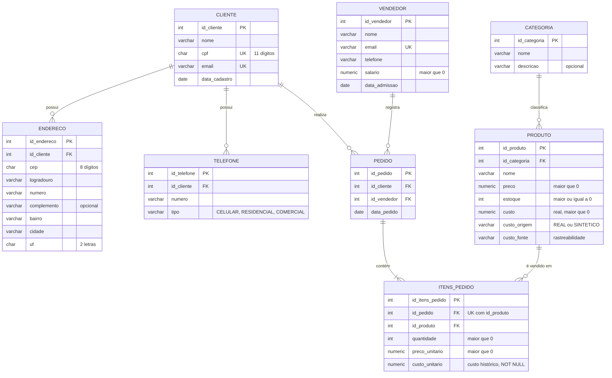
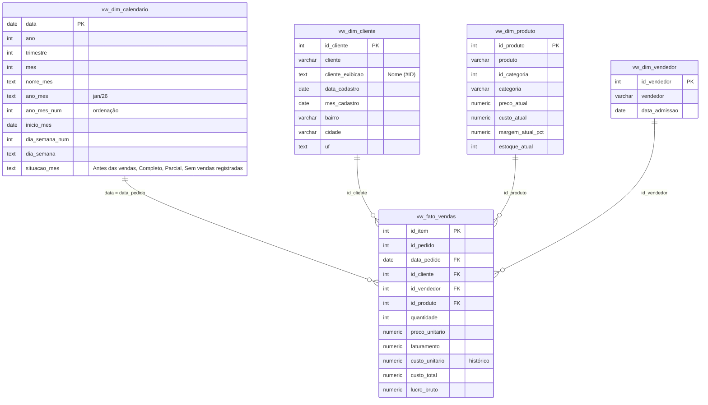
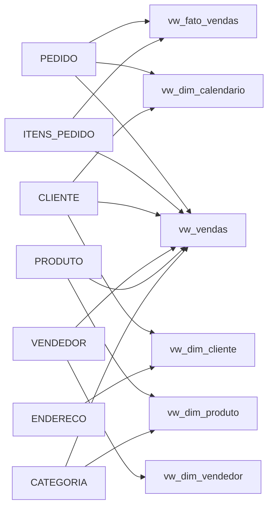

# Modelo de dados

Este documento substitui, como referência atual, o diagrama conceitual original em [documentacao/Modelagem_BRModelo.png](../documentacao/Modelagem_BRModelo.png). O original fica preservado como histórico.

Os diagramas usam Mermaid, que o GitHub desenha automaticamente.

---

## 1. Modelo transacional (tabelas)

**Mudanças em relação ao diagrama original:**

| Original (BRModelo) | Atual | Motivo |
|---|---|---|
| `PRODUTO` sem custo | `custo`, `custo_origem`, `custo_fonte` | C1: custo existia só no banco do autor |
| `ITENS_PEDIDO` sem custo | `custo_unitario` (custo histórico) | C10 |
| Cardinalidade mínima 1 em endereço, telefone e pedido | Mínima 0 (`o{`) | 30 dos 40 clientes não têm endereço nem telefone; um cliente pode existir sem pedido |
| Rótulos sobrepostos em `ENDERECO` | Diagrama legível | Correção de documentação |
| Sem unicidade em itens | `UNIQUE (id_pedido, id_produto)` | C8 |

**Regras que não cabem num diagrama** (validadas em `database/08_verificacoes_qualidade.sql`):
- data do pedido maior ou igual ao cadastro do cliente e à admissão do vendedor;
- todo pedido tem ao menos um item;
- `custo_total = quantidade × custo_unitario` em todas as linhas da fato.

---

## 2. Modelo analítico (estrela) para o Power BI

**Relacionamentos no Power BI:** todos 1:N, com filtro em direção única, das dimensões para a fato. `Calendario` é marcada como tabela de datas.

**Dados pessoais:** nenhuma dimensão expõe CPF, e-mail, telefone, logradouro, número, CEP ou salário. Um teste do `08` reprova a carga se alguma dessas colunas aparecer numa `vw_fato_*` ou `vw_dim_*`.

---

## 3. Linhagem das views

| View | Para que serve | Custo usado |
|---|---|---|
| `vw_vendas` | Contrato do relatório original (`F_vw_vendas`, 15 colunas fixas) | Custo **atual** do produto |
| `vw_fato_vendas` | Fato do novo modelo estrela | Custo **histórico** do item |

Hoje as duas somam R$ 258.699,00, porque o custo histórico foi registrado a partir do custo atual na carga inicial. Elas só passam a divergir se o custo de algum produto mudar depois. Essa divergência é esperada e é o motivo de existir o custo histórico ([C10](DECISOES_E_CORRECOES.md)).
